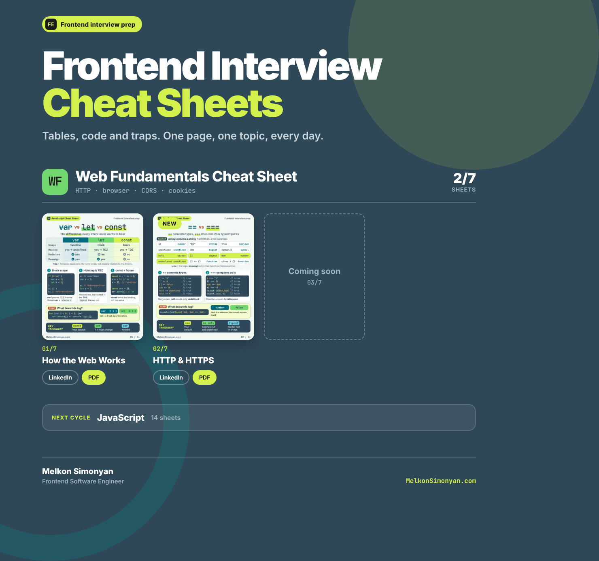
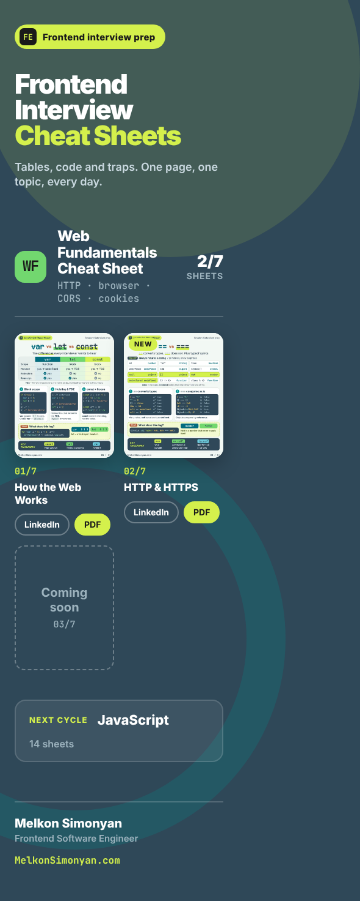

# Frontend Interview Cheat Sheets: website

The home of the **Frontend Interview Cheat Sheets** series, a daily one-page cheat sheet on one frontend topic
(tables, code and the traps interviewers love). Live at **https://cheatsheets.melkonsimonyan.com/**.

Each published sheet is listed with a preview, a link to the LinkedIn post and a link to the printable A4 PDF.
When a cycle is finished, a PDF magazine with all its pages is offered for download.





## Cycles

| Cycle | Sheets |
|-------|--------|
| Web Fundamentals | 7 |
| JavaScript | 14 |
| TypeScript | 14 |
| React | 14 |
| Next.js | 14 |
| Zustand | 7 |
| Forms, Zod, Yup | 7 |

## Tech

- [Next.js](https://nextjs.org/) (App Router) with **static export**: the build is plain HTML, CSS and files, no Node server
- TypeScript (strict), React server components only
- Plain CSS, local fonts through `next/font/local`, previews as pre-sized WebP
- All content is data in a single typed file, no CMS and no database

## Project structure

```
src/app/            layout, the single page, global styles
src/components/     CycleSection, PostCard, SoonCard
src/data/           types.ts and cycles.ts (the content)
src/fonts/          Inter and JetBrains Mono
public/thumbs/      post previews, WebP 600x750
public/pdf/         printable PDFs and cycle magazines
```

## Getting started

Requires Node.js 20 or newer.

```bash
npm install
npm run dev        # http://localhost:3000
npm run typecheck
npm run build      # static site in ./out
npx serve out      # preview the production build
```

## Add a post

1. Resize the sheet image to 600x750 WebP and save it as `public/thumbs/<cycle>-NN.webp`.
2. Copy the PDF to `public/pdf/<cycle>/NN-slug.pdf`.
3. Add one entry to `posts` in `src/data/cycles.ts`:

```ts
{ n: 3, title: 'How Browsers Work', thumb: '/thumbs/wf-03.webp',
  linkedin: 'https://www.linkedin.com/...', pdf: '/pdf/webfundamentals/03-how-browsers-work.pdf' },
```

A post appears on the page only when its `linkedin` value is set. The "Coming soon" card, the NEW badge and the
`published/total` counter are added automatically. A cycle with no published posts is hidden.

## Deploy

`npm run build` writes the site to `out/`. Upload the contents of `out/` to any static hosting (HTTPS on).
Every route is generated as a folder with an `index.html`.

## Content and license

The cheat sheets (texts, images, PDFs) are by Melkon Simonyan. The licence of the code is not specified yet.
